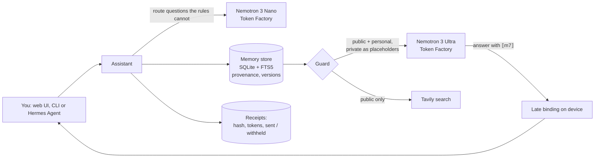

# Confidant

**A personal AI that keeps your secrets and shows its receipts.**

Confidant is a personal assistant whose memory you can audit and whose outbound traffic you can inspect.
Every memory carries its provenance and version history. A guard decides, memory by memory, what may leave
your device. When a private fact is needed, the cloud model never sees it: NVIDIA Nemotron on Nebius Token
Factory writes the answer with a placeholder such as `⟦m7⟧`, and Confidant fills in the real value locally.

- **Live demo:** https://huggingface.co/spaces/yannabadie/confidant (the Space clones this repository; see `space/`)
- **Video (under 3 minutes):** _YouTube link added at publication_
- Built for the Nebius × NVIDIA Global AI Hackathon, Personal AI track.

## Why

A useful personal assistant needs to remember your life: appointments, family, health, money, plans.
That is exactly the data you should not paste into a cloud model. Today you choose between a forgetful
assistant and one that knows too much. Confidant removes that trade-off with three properties you can check:

1. **Memory with receipts.** Each memory records who said it, where it came from (you, a web page, an
   inference), when, and every correction since. Answers cite memories as `[m12v2]`.
2. **A guard that withholds, not just a policy that promises.** Memories are classed `public`, `personal`
   or `private`. Each provider has an allow-list. Private memories are replaced by placeholders before any
   call leaves the device, and every outbound query (including web searches) is checked for private values.
3. **Receipts for every outbound call.** Provider, model, tokens, which memories were sent, which were
   withheld, and a SHA-256 of the exact messages sent. The Guard tab shows those messages for the last turn,
   so anyone can hash them and compare. "What left my device today" is a table, not a guess.

Some questions cannot be answered by a model that never learns when private items happen: "Am I free on
Wednesday morning?" depends on exactly that. Confidant checks those **on the device**, against the real dates,
private ones included, and makes no call at all.

## How Nemotron and Token Factory are used

| Step | Model (Nebius Token Factory) | Why this model |
|---|---|---|
| Route a question the local rules cannot route | Nemotron 3 Nano 30B-A3B (`nvidia/NVIDIA-Nemotron-3-Nano-30B-A3B`), reasoning off | fast and cheap: one short JSON object, with keyword rules as fallback ([router check](docs/router-check.md): 40 of 48 calls as expected). Messages that touch a private memory, carry a date, time or amount, ask about a period of your time ("What's on my plate next week?"), or that the rules recognise (remember, correct, search, brief, availability) are routed on the device |
| Compose the answer or the daily brief from guarded context | Nemotron 3 Ultra 550B-A55B (`nvidia/Nemotron-3-Ultra-550b-a55b`), reasoning on | reasoning over many memories while following the placeholder rules: copy `⟦m7⟧` verbatim, cite `[m6v1]`, never date a withheld item |

What we measured on Token Factory on 28 October 2026 ([`docs/token-factory-probe.md`](docs/token-factory-probe.md)):

- A reply that reaches `max_tokens` before its reasoning trace closes can arrive with the unfinished trace as its
  text, untagged; the first live daily brief was such a trace. Confidant never uses a reply that stopped at the
  token limit: the turn falls back to a local answer, says so, and is never recorded for replay. Answers get
  8,192 tokens; with its trace, the brief took 1,214 to 2,146 in the live runs.
- `chat_template_kwargs: {"enable_thinking": false}` switches Nemotron 3's reasoning off; `/no_think` in the
  prompt did not stop Nano. With reasoning on, Nano spent its 256 tokens thinking and returned no route.
- The six demo turns make 5 calls. In the live run the hosted demo replays: 5,640 tokens, about $0.013 at list
  prices; the route took 1 second, the answers 1.3 to 1.9 and the brief 5.4. In the live run filmed for the video:
  4,597 tokens, $0.0094.

The sensitivity of a new memory is decided on the device: asking a model whether a fact is private would show
it the fact. Keyword lists cannot name every illness or dispute, so a new fact is private unless the rules see
something clearly everyday or work-public. Messages that may carry a date, time or amount, in any form, are
routed on the device; the router sees the others with their values masked.

All calls use the OpenAI-compatible Token Factory API (`https://api.tokenfactory.nebius.com/v1`).
Model ids are discovered at start-up from `/v1/models` and can be pinned with `CONFIDANT_MODEL_REASON` and
`CONFIDANT_MODEL_FAST`. Web search uses **Tavily** when `TAVILY_API_KEY` is set (the recorded demo ran without
it, so its web step shows the guarded query and sends nothing); queries pass the same guard: private values are
removed from the query, or the search is blocked. Results are stored as `web` memories with their URL and
retrieval date.

## Architecture



## Try it

```bash
pip install -e ".[app]"
export NEBIUS_API_KEY=...        # on macOS: scripts/with-keys.sh reads it from the keychain
export TAVILY_API_KEY=...        # optional, enables web search
python -m confidant seed         # load the synthetic demo persona
python -m confidant chat         # terminal chat
python app.py                    # web UI on http://127.0.0.1:7860
```

Without a key, the app runs in clearly labelled **replay** mode, from the demo turns recorded live on
28 October 2026 in `data/replay/` (Nemotron 3 Ultra and Nano on Token Factory); with no recording there, it shows
hand-written sample answers, which the interface labels as samples.

### Use it from Hermes Agent (or any MCP client)

Confidant ships an MCP server (`python -m confidant serve-mcp`, standard library only) exposing
`memory_search`, `memory_record`, `memory_correct`, `memory_history`, `guarded_answer` and `daily_brief`.
MCP clients see private memories only as placeholders with their label. An availability question sent to
`guarded_answer` is checked on the device, and the client gets the shared items of that period only: saying
that a private item falls in it would date that item.

`integrations/hermes/` holds a reusable Hermes skill and the morning-brief job: a Hermes cron job in no-agent
mode runs [`confidant-brief.sh`](integrations/hermes/confidant-brief.sh), that is
`python -m confidant brief --delivery`, and sends its output to Telegram. The delivered text is built from the
draft, so each private item appears only as its label, and no Hermes model reads the memories. Setup:
[`integrations/hermes/README.md`](integrations/hermes/README.md); deliveries so far:
[`docs/hermes-deliveries.md`](docs/hermes-deliveries.md).

## Privacy model and limits

- The demo uses a **synthetic persona**; no real personal data is in this repository.
- The guard matches values (names, dates, times, amounts) and classes; it is a strong default, not a formal
  information-flow proof. It finds a protected value in the forms its scanners read and in the forms it writes
  out for that value ahead of time: the date and time formats of 82 CLDR locales (74 languages), number words
  in 44 languages, spoken forms such as `half ten` or `six grand` ([`confidant/forms.py`](confidant/forms.py)).
  Paraphrase, relative dates (`next Tuesday`) and forms outside those lists are not detected.
- **Adversarial leak test** ([`docs/leak-test.md`](docs/leak-test.md)): rounds of attack prompts, each written
  by an AI reviewer that did not write the guard (a separate Claude sub-agent) and run against a cooperative
  and a hostile fake model. Round 1 (65 prompts) found 20 leaks in the first version; rounds 2, 3 and 4, each
  written after the previous fixes, still found 27 of 45, 30 of 48 and 11 of 12. Most were values the user
  typed in forms the guard did not read; early versions also leaked from storage (labels built from a private
  fact's words, an old version, event order, sensitive facts stored as personal). The current version leaks 0
  of the 170, a regression result, not an estimate: no round has been written against it yet. Every failure
  and every fix is listed there.
- **Differential test** ([`tests/test_differential.py`](tests/test_differential.py)): values are not the only
  way to leak. A reviewer found that asking about Tuesday and about Monday put a private appointment's
  placeholder in the model's context only on its own day, which dated it (18 of 30 question pairs). Fixed:
  the test now moves the private appointments to other days and checks that nothing that leaves the device
  changes, through the chat and over MCP.
- Withheld items carry no date, so a cloud model cannot tell whether one falls in a given slot. Availability
  questions are therefore answered on the device, with no model call; the version that may be passed on (MCP,
  Telegram) lists shared items only.
- Late binding protects the value, not the existence of a withheld memory: the model sees "private: health
  appointment, value withheld", which is itself information. Labels name a category only ("health
  appointment", "private appointment", "housing cost", "finances"), never a word of the memory. Withheld items
  are listed apart, without dates, so their position in a list does not date them.
- Credentials are refused at write time (passwords, PINs, card numbers, API keys): Confidant never stores them.
- **Personal** memories (not private ones) may be sent to Token Factory when a task needs them, for example a
  birthday message; change the policy in `confidant/guard.py` to keep them local too.
- Receipts are written by Confidant itself: they show exactly what it sent, but they are not an external audit.

## Repository layout

| Path | Content |
|---|---|
| `confidant/` | memory store, guard, receipts, budget, Token Factory and Tavily clients, assistant, MCP server, CLI |
| `app.py`, `assets/` | Gradio web demo |
| `data/demo_persona.json` | the synthetic persona (25 memories) |
| `data/replay/` | the demo turns recorded live on 28 October 2026, replayed when no key is set (the correction and the refused PIN make no model call, so nothing is recorded for them) |
| `space/` | the three files of the Hugging Face Space |
| `scripts/` | macOS keychain wrapper, Token Factory probes (models, reasoning and token budgets), the router check, the live recorder and the offline leak test |
| `docs/` | leak test report and machine-readable results, the Token Factory probe, the router check, the Hermes deliveries |
| `integrations/hermes/` | Hermes Agent skill, the morning-brief cron script and its setup |
| `tests/` | offline test suite (all HTTP mocked) |

## Development

```bash
pip install -e ".[dev]"
python -m pytest -q
```

## License

MIT — see [LICENSE](LICENSE).
