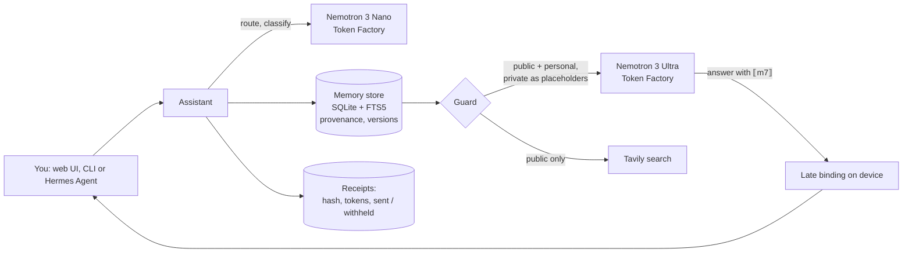

# Confidant

**A personal AI that keeps your secrets and shows its receipts.**

Confidant is an always-on personal assistant whose memory you can audit and whose privacy you can verify.
Every memory carries its provenance and version history. A guard decides, memory by memory, what may leave
your device. When a private fact is needed, the cloud model never sees it: NVIDIA Nemotron on Nebius Token
Factory writes the answer with a placeholder such as `⟦m7⟧`, and Confidant fills in the real value locally.

- **Live demo:** https://huggingface.co/spaces/yannabadie/confidant (the Space clones this repository; see `space/`)
- **Video (under 3 minutes):** _YouTube link added at publication_
- Built for the Nebius × NVIDIA Global AI Hackathon, Personal AI track.

## Why

A useful personal assistant needs to remember your life: appointments, family, health, money, plans.
That is exactly the data you should not paste into a cloud model. Today you choose between a forgetful
assistant and one that knows too much. Confidant removes that trade-off with three properties you can check:

1. **Memory with receipts.** Each memory records who said it, where it came from (you, a web page, an
   inference), when, and every correction since. Answers cite memories as `[m12v2]`.
2. **A guard that withholds, not just a policy that promises.** Memories are classed `public`, `personal`
   or `private`. Each provider has an allow-list. Private memories are replaced by placeholders before any
   call leaves the device, and every outbound query (including web searches) is checked for private values.
3. **Receipts for every outbound call.** Provider, model, tokens, which memories were sent, which were
   withheld, and a SHA-256 of the exact payload. "What left my device today" is a table, not a guess.

## How Nemotron and Token Factory are used

| Step | Model (Nebius Token Factory) | Why this model |
|---|---|---|
| Route the request (answer, remember, correct, search, brief) | Nemotron 3 Nano | fast, cheap, strict JSON |
| Classify a new memory's sensitivity | Nemotron 3 Nano | runs on every new fact |
| Compose the answer or the daily brief from guarded context | Nemotron 3 Ultra | long-context reasoning over many memories |

All calls use the OpenAI-compatible Token Factory API (`https://api.tokenfactory.nebius.com/v1`).
Model ids are discovered at start-up from `/v1/models` and can be pinned with `CONFIDANT_MODEL_REASON` and
`CONFIDANT_MODEL_FAST`. Web search uses **Tavily**; queries pass the same guard, so the web never learns
your private facts. Results are stored as `web` memories with their URL and retrieval date.

## Architecture



## Try it

```bash
pip install -e ".[app]"
export NEBIUS_API_KEY=...        # on macOS: scripts/with-keys.sh reads it from the keychain
export TAVILY_API_KEY=...        # optional, enables web search
python -m confidant seed         # load the synthetic demo persona
python -m confidant chat         # terminal chat
python app.py                    # web UI on http://127.0.0.1:7860
```

Without a key, the app runs in clearly labelled **replay** mode from recorded turns.

### Use it from Hermes Agent (or any MCP client)

Confidant ships a dependency-free MCP server exposing `memory_search`, `memory_record`, `memory_correct`,
`memory_history` and `guarded_answer`:

```bash
hermes mcp add confidant --command python3 --args -m confidant serve-mcp
```

## Privacy model and limits

- The demo uses a **synthetic persona**; no real personal data is in this repository.
- The guard matches values (names, dates, amounts) and classes; it is a strong default, not a formal
  information-flow proof. Paraphrased leaks of a private value are not detected.
- Late binding protects the value, not the existence of a withheld memory: the model sees "private:
  dermatologist appointment, value withheld", which is itself information. Labels are chosen to be generic.
- Credentials are refused at write time (passwords, PINs, card numbers, API keys): Confidant never stores them.

## Repository layout

| Path | Content |
|---|---|
| `confidant/` | memory store, guard, receipts, budget, Token Factory and Tavily clients, assistant, MCP server, CLI |
| `app.py`, `assets/` | Gradio web demo |
| `data/demo_persona.json` | the synthetic persona (25 memories) |
| `data/replay/` | recorded Nemotron outputs used only in replay mode |
| `space/` | the three files of the Hugging Face Space |
| `scripts/` | macOS keychain wrapper and a Token Factory probe |
| `tests/` | offline test suite (all HTTP mocked) |

## Development

```bash
pip install -e ".[dev]"
python -m pytest -q
```

## License

MIT — see [LICENSE](LICENSE).
