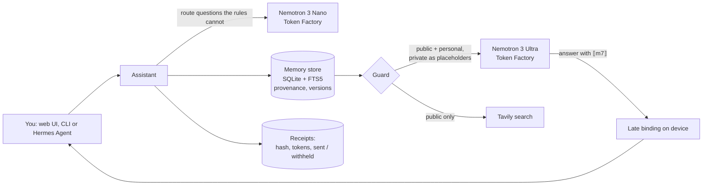

# Confidant

**A personal AI that keeps your secrets and shows its receipts.**

Confidant is a personal assistant whose memory you can audit and whose outbound traffic you can inspect.
Every memory carries its provenance and version history. A guard decides, memory by memory, what may leave
your device. When a private fact is needed, the cloud model never sees it: NVIDIA Nemotron on Nebius Token
Factory writes the answer with a placeholder such as `⟦m7⟧`, and Confidant fills in the real value locally.

- **Hosted demo:** https://huggingface.co/spaces/yannabadie/confidant. It replays the demo turns recorded live on
  Token Factory on 28 October and says so in its header; with your own key, the same code runs live (below).
  The Space clones this repository; see `space/`.
- **Video (2 min 58 s):** https://youtu.be/aag9bRc5n34
- Built for the Nebius × NVIDIA Global AI Hackathon, Personal AI track.

## Why

A useful personal assistant needs to remember your life: appointments, family, health, money, plans.
That is exactly the data you should not paste into a cloud model. Today you choose between a forgetful
assistant and one that knows too much. Confidant removes that trade-off with three properties you can check:

1. **Memory with receipts.** Each memory records who said it, where it came from (you, a web page, an
   inference), when, and every correction since. Answers cite memories as `[m12v2]`.
2. **A guard that withholds, not just a policy that promises.** Memories are classed `public`, `personal`
   or `private`. Each provider has an allow-list. Private memories are replaced by placeholders before any
   call leaves the device, and every outbound query (including web searches) is checked for private values.
3. **Receipts for every outbound call.** Provider, model, tokens, which memories were sent, which were
   withheld, and a SHA-256 of the exact messages sent. A request that left and got no answer (an HTTP 503, a
   timeout, the first try before a retry) has its receipt too. The Guard tab shows those messages for the last
   turn, so anyone can hash them and compare. "What left my device today" is a table, not a guess.

Placeholders hide what a private memory says. Confidant also hides **when** it happens: the Guard tab's
**Prove it** check ([`confidant/proof.py`](confidant/proof.py)) rebuilds the last turn's requests on the
device, as the memory is and with every private appointment moved to another week, weekday and hour, and
shows the two SHA-256 side by side. They are identical, for a demo question or one of your own; the same
comparison runs on 30 question pairs in [`tests/test_differential.py`](tests/test_differential.py).

Some questions cannot be answered by a model that never learns when private items happen: "Am I free on
Wednesday morning?" depends on exactly that. Confidant checks those **on the device**, against the real dates,
private ones included, and makes no call at all.

## How Nemotron and Token Factory are used

| Step | Model (Nebius Token Factory) | Why this model |
|---|---|---|
| Route a question the local rules cannot route | Nemotron 3 Nano 30B-A3B (`nvidia/NVIDIA-Nemotron-3-Nano-30B-A3B`), reasoning off | fast and cheap: one short JSON object, with keyword rules as fallback ([router check](docs/router-check.md): 40 of 48 calls as expected). Messages that touch a private memory, carry a date, time or amount, ask about a period of your time ("What's on my plate next week?"), or that the rules recognise (remember, correct, search, brief, availability) are routed on the device |
| Compose the answer or the daily brief from guarded context | Nemotron 3 Ultra 550B-A55B (`nvidia/Nemotron-3-Ultra-550b-a55b`), reasoning on | reasoning over many memories while following the placeholder rules: copy `⟦m7⟧` verbatim, cite `[m6v1]`, never date a withheld item |

What we measured on Token Factory on 28 October 2026 ([`docs/token-factory-probe.md`](docs/token-factory-probe.md)):

- A reply that reaches `max_tokens` before its reasoning trace closes can arrive with the unfinished trace as its
  text, untagged; the first live daily brief was such a trace. Confidant never uses a reply that stopped at the
  token limit: the turn falls back to a local answer, says so, and is never recorded for replay. Answers get
  8,192 tokens; with its trace, the brief took 1,214 to 2,146 in the live runs.
- `chat_template_kwargs: {"enable_thinking": false}` switches Nemotron 3's reasoning off; `/no_think` in the
  prompt did not stop Nano. With reasoning on, Nano spent its 256 tokens thinking and returned no route.
- The six demo turns make 5 calls. In the live run the hosted demo replays (28 October, 17:48 UTC): 5,824
  tokens, about $0.013 at list prices; the route took 0.3 seconds, the answers 1.4 to 4.6 and the brief 4.2
  (receipts and transcript in [`docs/evidence/`](docs/evidence/README.md)). An earlier recording, at 07:30 UTC,
  took 5,640 tokens. In the live run filmed for the video (28 October, 19:28 UTC): 5,164 tokens, $0.0106,
  on screen in its Receipts tab.

The sensitivity of a new memory is decided on the device: asking a model whether a fact is private would show
it the fact. Keyword lists cannot name every illness or dispute, so a new fact is private unless the rules see
something clearly everyday or work-public. Messages that may carry a date, time or amount, in any form, are
routed on the device; the router sees the others with their values masked.

**Where Token Factory helped.** A 550-billion-parameter model answered in 1.4 to 4.6 seconds with no GPU to provision or deploy; one key reached the three Nemotron models (Ultra for answers, Nano for routing, Super for the Hermes agent) through one OpenAI-compatible API; reasoning could be switched off per call for the router; and the usage fields of every reply feed Confidant's receipts. A run of the demo costs about $0.013.

All calls use the OpenAI-compatible Token Factory API (`https://api.tokenfactory.nebius.com/v1`).
Model ids are discovered at start-up from `/v1/models` and can be pinned with `CONFIDANT_MODEL_REASON` and
`CONFIDANT_MODEL_FAST`. Web search uses **Tavily** when `TAVILY_API_KEY` is set (the recorded demo ran without
it, so its web step shows the guarded query and sends nothing); queries pass the same guard: private values are
removed from the query, or the search is blocked. Results are stored as `web` memories with their URL and
retrieval date.

## Architecture



## Try it

```bash
pip install -e ".[app]"
export NEBIUS_API_KEY=...        # on macOS: scripts/with-keys.sh reads it from the keychain
export TAVILY_API_KEY=...        # optional, enables web search
python -m confidant seed         # load the synthetic demo persona
python -m confidant chat         # terminal chat
python app.py                    # web UI on http://127.0.0.1:7860
```

Without a key, the app runs in clearly labelled **replay** mode, from the demo turns recorded live on
28 October 2026 in `data/replay/` (Nemotron 3 Ultra and Nano on Token Factory); with no recording there, it shows
hand-written sample answers, which the interface labels as samples. Replay answers only the recorded questions,
matched exactly (case, accents, punctuation and contractions aside); another question gets the memories that
match it and no model answer. Remembering, corrections, availability and refusals need no model, so they run
in replay as they do live.

### Use it from Hermes Agent (or any MCP client)

Confidant ships an MCP server (`python -m confidant serve-mcp`, standard library only) exposing
`memory_search`, `memory_record`, `memory_correct`, `memory_history`, `guarded_answer` and `daily_brief`.
An MCP client never gets a private memory's text: `memory_search` leaves private memories out, and ranks the
others without them (which private memories match an agent's words, or how they would weigh in the ranking,
would tell it what they say); the other tools show a placeholder with a category label,
and a private memory recorded over MCP gets a category label whatever label the client sends. An availability
question sent to `guarded_answer` is checked on the device, and the client gets the shared items of that period
only: saying that a private item falls in it would date that item. A client's own request is sent to Nebius
as it wrote it, values masked by kind and credentials refused, after the check of the context: redacting only
the words that equal a private value would tell the client which of its guesses are right. `memory_history`
withholds every version of a memory that is now private. Start the server with `--reveal-private` for a client
of your own that may see everything.

A Hermes agent that runs on Nemotron 3 Super through Token Factory used these tools on 28 October: it got the
week with placeholders, an availability answer that dates no private item, and when it tried to store a
cardiologist visit as personal under its own label, Confidant stored it as private with a category label
([`docs/hermes-agent-session.md`](docs/hermes-agent-session.md)). The agent's own model, on Token Factory, had
written that sentence in its tool call, so it had read it first: a guard on the device protects what it stores,
from then on, not what an agent read before.

`integrations/hermes/` holds a reusable Hermes skill, that agent's profile and the morning-brief job: a Hermes
cron job in no-agent mode runs [`confidant-brief.sh`](integrations/hermes/confidant-brief.sh), that is
`python -m confidant brief --delivery`, and sends its output to Telegram. The delivered text is built from the
draft, so each private item appears only as its label, and no Hermes model reads the memories. Setup:
[`integrations/hermes/README.md`](integrations/hermes/README.md); deliveries so far:
[`docs/hermes-deliveries.md`](docs/hermes-deliveries.md).

## Privacy model and limits

- The demo uses a **synthetic persona**; no real personal data is in this repository.
- The guard matches values (names, dates, times, amounts) and classes; it is a strong default, not a formal
  information-flow proof. It finds a protected value in the forms its scanners read and in the forms it writes
  out for that value ahead of time: the date and time formats of 82 CLDR locales (74 languages), number words
  in 44 languages, spoken forms such as `half ten` or `six grand` ([`confidant/forms.py`](confidant/forms.py)).
  Paraphrase, relative dates (`next Tuesday`) and forms outside those lists are not detected.
- **Adversarial leak test** ([`docs/leak-test.md`](docs/leak-test.md)): rounds of attack prompts, each written
  by an AI reviewer that did not write the guard (a separate Claude sub-agent) and run against a cooperative
  and a hostile fake model. Round 1 (65 prompts) found 20 leaks in the first version; rounds 2, 3 and 4, each
  written after the previous fixes, still found 27 of 45, 30 of 48 and 11 of 12. Most were values the user
  typed in forms the guard did not read; early versions also leaked from storage (labels built from a private
  fact's words, an old version, event order, sensitive facts stored as personal). A sixth review, on
  28 October, went through the MCP tools instead of the chat and found three leaks there (search results,
  labels, the guard field), plus sensitive facts still stored as personal; a seventh, on the fixes, found two
  more (which shared memories an agent got back, and in what order, depended on the words of private ones);
  an eighth, on those fixes, found three more oracles (how an agent's own request was redacted, which private
  memories the brief picked, public web text redacted where it equalled a private value) and a placeholder
  that dated itself by leaving the brief once its day had passed. Those eight rounds came from Claude agents,
  and Claude also wrote the guard, so **round 9 was written by NVIDIA Nemotron 3 Ultra** on Token Factory
  ([`scripts/nemotron_attack_round.py`](scripts/nemotron_attack_round.py); its prompt and reply are in
  [`docs/round9/`](docs/round9/README.md)): 4 of its 29 messages leaked on the round-8 code, all through a day
  of the month typed back ("rent ... on the 5th"). Each finding is now a test
  ([`tests/test_review_round6.py`](tests/test_review_round6.py) to
  [`tests/test_review_round9.py`](tests/test_review_round9.py)). The current version leaks 0 of the 199
  prompts, a regression result, not an estimate: no round has been written against it yet. Every failure and
  every fix is listed there.
- **Differential test** ([`tests/test_differential.py`](tests/test_differential.py)): values are not the only
  way to leak. A reviewer found that asking about Tuesday and about Monday put a private appointment's
  placeholder in the model's context only on its own day, which dated it (18 of 30 question pairs). Fixed:
  the test now moves the private appointments to other days and checks that nothing that leaves the device
  changes, through the chat and over MCP.
- Withheld items carry no date, and a question that names a time, the brief and every agent's question get the
  same list of them whatever the period and whatever the day, so a cloud model cannot tell whether one falls in
  a given slot, nor when one is over. That list goes whole (up to 60 items), outside the cap of 10 memories picked
  for the message. The answer shown on the device then leaves out the private items that are over or outside the
  period asked, and puts the others in date order; the draft that may be passed on keeps the model's text.
  Availability questions are answered on the device, with no model call; the version that may be passed on
  (MCP, Telegram) lists shared items only.
- Dates, clock times and days of the month that you type are masked alike in what Nebius gets ("What's on
  [date]?"), and put back in the answer shown on the device: masked only when they equal a private value, as
  until 28 October, they told Nebius which dates hold a private item (the Prove it check found it). For the
  same reason they never make a message private by themselves. Typed amounts and names are still masked only
  when they equal a stored value, and a web query still loses a typed value equal to a private one, which tells
  the search provider that it matched.
- A chat question that names no time selects memories by its words, private ones included as placeholders:
  asking about "the dermatologist" tells the cloud model that a private health item matches that word.
- Late binding protects the value, not the existence of a withheld memory: the model sees "private: health
  appointment, value withheld", which is itself information. Labels name a category only ("health
  appointment", "private appointment", "housing cost", "savings"), never a value (no name, date, time or
  amount), though the category word may also be in the memory. Withheld items are listed apart, without dates,
  so their position in a list does not date them.
- Credentials are refused before anything is stored or sent: passwords and PINs in English, French, German,
  Spanish, Italian and Portuguese, written with gaps, dots, slashes or in words (`PIN is 4 8 2 1`, `4.8.2.1`,
  `4/8/2/1`, `four eight two one`, `forty-eight twenty-one`, `quattro otto due uno`), the value first (`4821 is my
  bank PIN`) or after a longer description (`my bank PIN, the one I chose at the branch, is 4821`), unlock codes
  and combinations, a login or sign-in with its password, card numbers
  and the digits on the back of a card, recovery phrases, identity and passport numbers, and API keys
  ([`tests/test_credential_forms.py`](tests/test_credential_forms.py)). These are patterns, not understanding. A
  code phrased in a way they miss (`my bank PIN is the year my mum was born, 1957`) is stored like any new fact:
  private, so never sent, when a lock or unlock word sits next to a number, when a sensitive word is in it, or
  when nothing in it is clearly everyday; otherwise personal, and personal memories may be sent when a task
  needs them.
- **Personal** memories (not private ones) may be sent to Token Factory when a task needs them, for example a
  birthday message; change the policy in `confidant/guard.py` to keep them local too.
- Receipts are written by Confidant itself: they show exactly what it sent, but they are not an external audit.

## Repository layout

| Path | Content |
|---|---|
| `confidant/` | memory store, guard, receipts, budget, Token Factory and Tavily clients, assistant, MCP server, CLI, the Prove it check |
| `app.py`, `assets/` | Gradio web demo |
| `data/demo_persona.json` | the synthetic persona (25 memories) |
| `data/replay/` | the demo turns recorded live on 28 October 2026, replayed when no key is set (the correction and the refused PIN make no model call, so nothing is recorded for them). Each holds the SHA-256 of every request it sent, the hashes of its receipts; replay answers only a request with the same hash, so a memory you add makes the recording decline instead of answering a request it never saw |
| `space/` | the three files of the Hugging Face Space |
| `scripts/` | macOS keychain wrapper, Token Factory probes (models, reasoning and token budgets), the router check, the live recorder, the offline leak test and the script that has Nemotron write an attack round |
| `docs/` | leak test report and machine-readable results, round 9's call to Nemotron (`round9/`), receipts and raw logs of the live runs (`evidence/`), the Token Factory probe, the router check, the Hermes deliveries and the Hermes agent session |
| `integrations/hermes/` | Hermes Agent skill, the agent profile, the morning-brief cron script and its setup |
| `tests/` | offline test suite (all HTTP mocked) |

## Development

```bash
pip install -e ".[dev]"
python -m pytest -q
```

## License

MIT — see [LICENSE](LICENSE).
